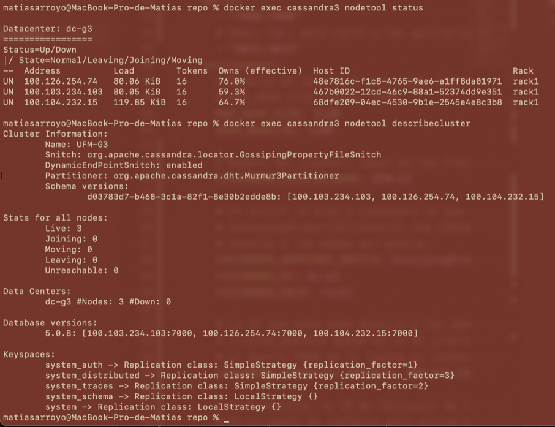
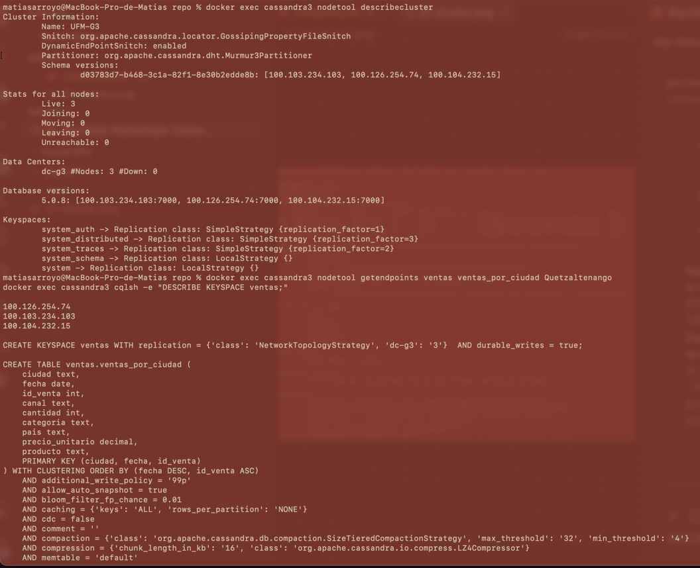
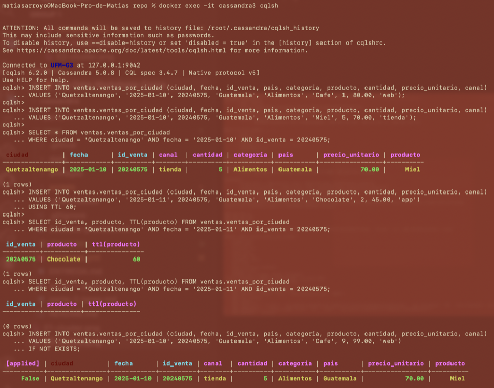
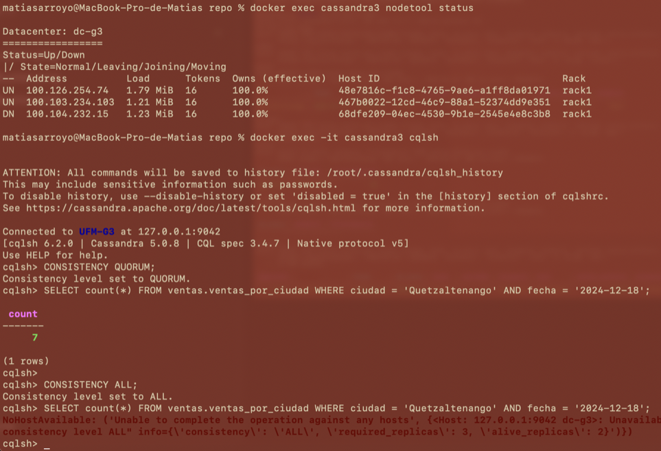
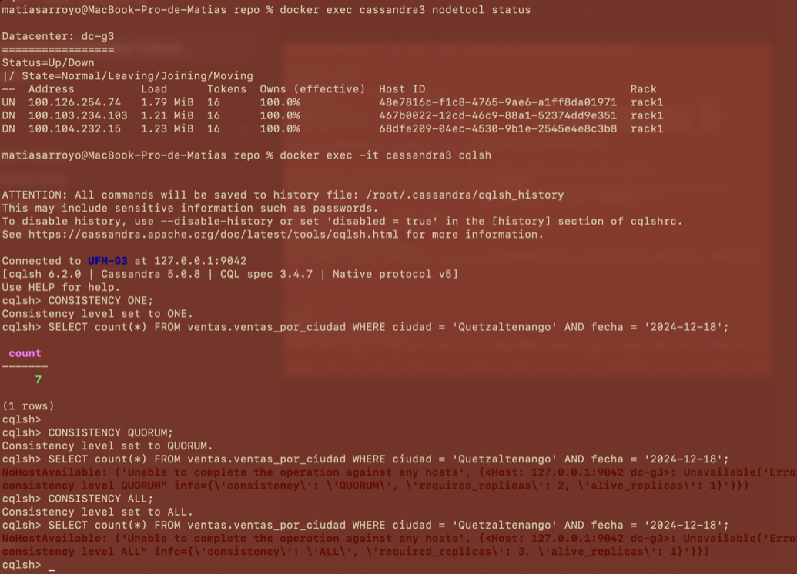
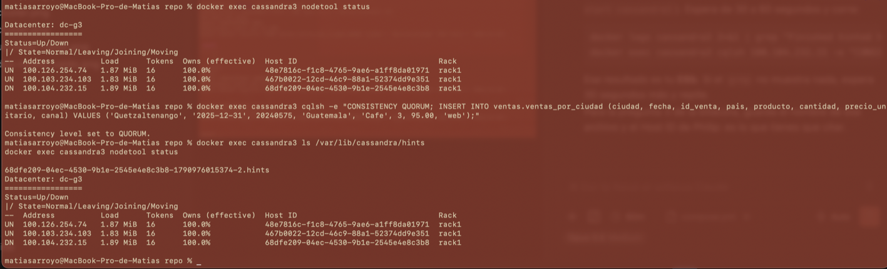
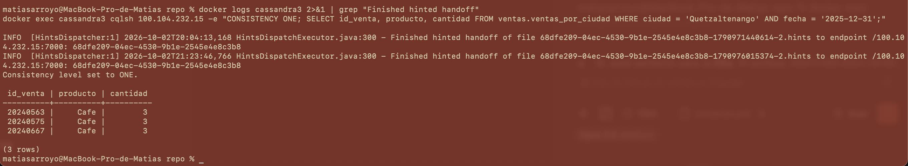

# Bitácora del taller de Cassandra

- **Nombre:** Matías Arroyo
- **Carné:** 20240575
- **Grupo:** G3
- **Tu nodo en el clúster del grupo:** cassandra3 (100.126.254.74)

---

## 1. Evidencias

### E1. Tres nodos en tu clúster y tu datacenter

Los tres nodos del grupo salen UN en el datacenter dc-g3, cada uno con la IP de Tailscale de su laptop. En describecluster se ve que el clúster se llama UFM-G3.

### E2. Las copias de la partición de Quetzaltenango

La partición de Quetzaltenango está en los tres nodos (100.126.254.74, 100.103.234.103 y 100.104.232.15). El keyspace ventas usa NetworkTopologyStrategy con 3 copias en dc-g3.

### E3. Upsert, TTL e IF NOT EXISTS

Los dos INSERT con la misma llave dejaron una sola fila, con los datos del segundo. La fila con TTL 60 mostraba su tiempo restante y después de un minuto ya no salía (0 rows). El INSERT con IF NOT EXISTS devolvió [applied] False y la fila que ya existía.

### E4. Un nodo caído: QUORUM frente a ALL

Con el nodo de Philip en DN, la lectura con QUORUM respondió (count 7) y la misma lectura con ALL se rechazó porque había 2 copias vivas y necesitaba 3.

### E5. Dos nodos caídos: ONE frente a QUORUM

Con dos nodos en DN y solo el mío arriba, ONE respondió (count 7) y QUORUM se rechazó porque necesitaba 2 copias y solo había 1.

### E6a. El hint guardado para el nodo caído

Después de escribir mi venta con el nodo de Philip apagado, apareció el archivo 68dfe209-04ec-4530-9b1e-2545e4e8c3b8-1790976015374-2.hints. Empieza con el mismo Host ID de la fila DN de Philip.

### E6b. La entrega del hint

Cuando Philip encendió su nodo, el log de mi nodo mostró Finished hinted handoff hacia 100.104.232.15. Después leí mi venta 20240575 directamente desde su nodo con ONE y ya estaba.

### Tabla del Paso 8

| Nodos caídos | `ONE` | `QUORUM` | `ALL` |
|---|---|---|---|
| 0 | ✅ | ✅ | ✅ |
| 1 | ✅ | ✅ | ❌ |
| 2 | ✅ | ❌ | ❌ |

---

## 2. Preguntas

**1. ¿Qué línea de la traza muestra que la consulta por ciudad leyó una sola partición, y cuál que la de producto recorrió toda la tabla? ¿Por qué Cassandra rechaza la segunda sin ALLOW FILTERING?**

En la consulta por ciudad (Quetzaltenango, 2024-12-18) la traza dice "Executing single-partition query on ventas_por_ciudad" y "Read 7 live rows and 0 tombstone cells", o sea que fue directo a una partición y solo leyó las 7 filas que pedí. En la de producto salen varias veces "Submitting range requests on 17 ranges" y "Executing seq scan across 3 sstables", y sumando los "Read N live rows" da las 75000 filas, aunque solo había 4849 de Miel. A mí me tardó 346798 µs, contra unos 1540 µs la de ciudad. Cassandra la rechaza porque producto no es parte de la llave, entonces no sabe en qué partición buscar y tendría que leer toda la tabla en todos los nodos.

**2. ¿Qué lecturas se comportaron como CP y cuáles como AP? ¿Qué nivel usarías para el saldo de una cuenta y cuál para un contador de reproducciones, y por qué?**

ONE se comportó como AP, porque respondió hasta con dos nodos caídos. ALL con un nodo caído y QUORUM con dos caídos se comportaron como CP: prefirieron fallar antes que responder con menos copias. En mi caso el error decía "required_replicas: 3, alive_replicas: 2" para ALL y "required_replicas: 2, alive_replicas: 1" para QUORUM. Para el saldo de una cuenta usaría QUORUM, porque no puedo arriesgarme a mostrar un saldo viejo y aun así aguanta un nodo caído. Para un contador de reproducciones usaría ONE, porque si el número está un poco atrasado no pasa nada y lo importante es que siempre responda.

**3. ¿Cómo se enteró el nodo apagado de tu venta? ¿Qué pasaría si el nodo estuviera apagado más tiempo que max_hint_window?**

Cuando escribí mi venta (id 20240575) con QUORUM, el nodo de Philip estaba apagado, entonces mi nodo guardó un hint para él en el archivo 68dfe209-04ec-4530-9b1e-2545e4e8c3b8-1790976015374-2.hints, que tiene el mismo Host ID que su fila DN. Cuando Philip encendió su nodo, mi nodo le entregó el hint y en el log salió "Finished hinted handoff of file 68dfe209-04ec-4530-9b1e-2545e4e8c3b8-1790976015374-2.hints to endpoint /100.104.232.15:7000". Después leí mi venta desde su nodo y ya estaba. Si el nodo estuviera apagado más que max_hint_window (3 horas por defecto), se dejan de guardar hints y esa venta no le llegaría sola; habría que correr nodetool repair.

---

## 3. Mini-reto

### Tablas

| Tabla | Consulta que responde | Partition key | Clustering key |
|---|---|---|---|
| `usuarios_por_id` | C1 | `usuario_id` | — |
| `mensajes_por_canal` | C2 | `canal_id` | `enviado_en DESC, mensaje_id` |
| `mensajes_por_usuario` | C3 | `usuario_id` | `enviado_en DESC, mensaje_id` |
| `mensajes_por_canal_y_dia` | C4 | `(canal_id, dia)` | `enviado_en DESC, mensaje_id` |

El keyspace es discord_20240575, con 3 copias en dc-g3. Las cuatro consultas dan lo mismo que consultas.sql: camila7188, los 20 mensajes de ch16, los 10 de du186 y 17 mensajes en ch16 el 2026-09-04.

### Justificación

**Por qué esas llaves:**

En cada tabla puse como partition key lo que va en el WHERE de la consulta, así cada consulta lee una sola partición y no hace falta ALLOW FILTERING. En C2 y C3 piden los mensajes más recientes, entonces la clustering key es enviado_en DESC: los mensajes ya quedan guardados del más nuevo al más viejo y el LIMIT solo agarra los primeros. Agregué mensaje_id al final para que dos mensajes del mismo segundo no se pisen. En C4 la partición es canal más día, así contar los mensajes de un día lee una partición chiquita (máximo 17 mensajes) y no todo el canal.

**Qué datos quedaron duplicados entre tablas:**

Los mensajes están guardados tres veces, uno en cada tabla de mensajes. Como no hay JOIN, copié el nombre del usuario dentro de mensajes_por_canal, y el nombre del canal y del servidor dentro de mensajes_por_usuario. El contenido del mensaje está en dos tablas. Esos JOIN los hice una sola vez al cargar los datos con carga.py.

**Qué hace la aplicación si cambia un dato duplicado:**

La aplicación tiene que cambiarlo en todas las tablas donde está, porque Cassandra no lo hace sola. Por ejemplo, si un usuario cambia su nombre, hay que actualizarlo en usuarios_por_id y en todos sus mensajes de mensajes_por_canal. Para saber cuáles son esos mensajes se usa mensajes_por_usuario, que tiene el canal, la hora y el id de cada uno. Lo mejor es mandar esos cambios juntos en un BATCH para que no quede una tabla actualizada y otra no. Si se edita o borra un mensaje, hay que hacerlo en las tres tablas.

---

## 4. Problemas encontrados (opcional)

En mi Mac el puerto 7000 estaba ocupado por el Receptor AirPlay, y el nodo no podía usarlo. Lo apagué en Ajustes del Sistema y ya funcionó. La primera vez que levanté mi nodo se cayó con "Other bootstrapping/leaving/moving nodes detected" porque otro nodo se estaba uniendo al mismo tiempo; lo borré con docker compose down -v y lo volví a levantar cuando los otros dos ya estaban UN. Además, en los datos de G3 Quetzaltenango no tiene ventas el 2024-08-01, así que usé el 2024-12-18 para las consultas por ciudad.
